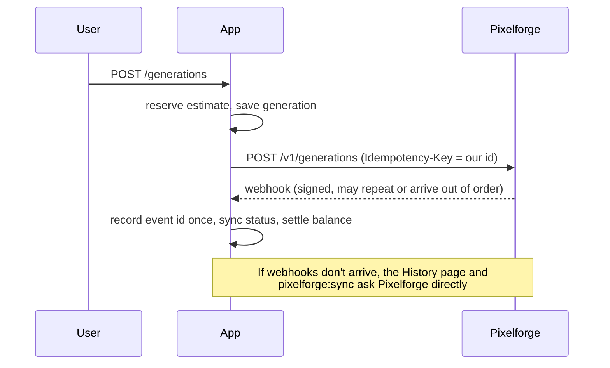

# Pixeltest

An image generation app built with Laravel 13, Inertia v3 and Vue 3. Users write a prompt, pick a size and quality, and the app sends the request to [Pixelforge](https://pixelforge.promptedit.dev/docs). It tracks each generation live and charges the user Pixelforge's cost plus a 25% markup.

## Features

- **Generate** (`/generate`): prompt, size, quality and up to 4 reference image URLs. The page shows the maximum possible price before you submit.
- **History** (`/history`): every generation with its live status (queued, processing, succeeded or failed), the estimated cost, the actual cost and the image.
- **Credits**: each user has a balance. "Buy $10 credits" adds credits through a fake purchase. Generating is blocked when the balance can't cover the estimate.
- **Webhooks** (`POST /webhooks/pixelforge`): signature-verified. An event delivered twice is only recorded once, and events that arrive out of order never move a generation back to an earlier status.
- **Admin report** (`/admin/report`): charged amount, provider cost and profit per UTC day and per user, next to the cost Pixelforge reports in `GET /v1/usage`.

## How billing works

- All money is stored as **integer nanodollars** (1 USD = 1,000,000,000), so fractions of a cent stay exact. The pricing math is in `app/Services/PixelforgeCost.php`.
- When a user submits, the app reserves the **upper-bound estimate** from their balance. It assumes the most text and reasoning tokens Pixelforge allows.
- When the generation succeeds, the user pays `ceil(provider cost × 1.25)` and the rest of the reservation goes back to their balance. When it fails, the whole reservation is refunded.
- Provider cost is calculated from the generation's `usage` and the `rates` that were fixed when it was created, so it matches Pixelforge's own usage report.

## How generations reach their final state



There are three ways the app learns that a generation finished, and they all apply the result the same way (`Generation::syncWith`):

1. **Webhooks**: the main path.
2. **The History page**: while a generation is pending, the page asks Pixelforge for its status as it refreshes, at most once every 10 seconds per generation.
3. **The `pixelforge:sync` command**: the scheduler runs it every minute. It handles generations stuck for more than 2 minutes, and resubmits any whose create request timed out.

### Events

| Event | Listener | What it does |
|---|---|---|
| `GenerationRequested` | `SubmitGenerationToPixelforge` | Sends the generation to Pixelforge. If Pixelforge rejects it, marks it failed and shows the error on the form. |
| `GenerationSucceeded` | `ChargeForGeneration` | Charges the actual price and refunds the rest of the reservation. |
| `GenerationFailed` | `RefundGeneration` | Refunds the whole reservation. |
| `PixelforgeWebhookReceived` | `SyncGenerationFromWebhook` | Applies the webhook to the matching generation. |

All four listeners must run immediately, not on a queue. The webhook listeners share a database transaction with the event-id record that prevents double processing, and a Pixelforge rejection has to reach the user on the same request.

## Requirements

- PHP 8.3+, Composer, Node 20+
- SQLite locally (the default). MySQL or Postgres also work.
- A Pixelforge API key and that key's webhook signing secret.

## Setup

```bash
composer run setup   # install, .env, key, migrate, build assets
```

Then add these to `.env`:

```dotenv
PIXEL_API=pf_...                       # Pixelforge API key
PIXELFORGE_WEBHOOK_SECRET=whsec_...    # signing secret for that key
# PIXELFORGE_URL=https://pixelforge.promptedit.dev/v1   (default)
```

Run the app:

```bash
composer run dev          # server, queue, logs, Vite
php artisan schedule:work # runs pixelforge:sync every minute
```

**Local webhooks:** Pixelforge refuses `localhost` and private addresses. Without a tunnel (Expose, ngrok, Cloudflare Tunnel), generations still finish through the History page refresh and `pixelforge:sync`. To receive real webhooks, set the key's webhook URL in the Pixelforge dashboard to `https://<tunnel>/webhooks/pixelforge`.

### Making an admin

```bash
php artisan tinker --execute 'App\Models\User::where("email", "you@example.com")->update(["is_admin" => true]);'
```

## Testing

```bash
php artisan test --compact
```

If your shell exports `APP_ENV=local`, run `APP_ENV=testing php artisan test`. Otherwise CSRF checks stay on and requests fail with 419.

Code quality:

```bash
vendor/bin/pint            # PHP formatting
vendor/bin/phpstan analyse # static analysis
npm run types:check        # Vue / TypeScript
npm run check              # lint + format
```

Pixelforge's test keywords are useful in prompts: `[succeed]`, `[fail]`, `[slow]`, `[duplicate]`, `[blocked]`, `[overloaded]`.

## Deployment (Laravel Cloud or any host)

1. Set `PIXEL_API`, `PIXELFORGE_WEBHOOK_SECRET` and the database variables, then run `php artisan migrate --force`.
2. Turn on the **scheduler** so `pixelforge:sync` runs.
3. In the Pixelforge dashboard, set the webhook URL to `https://<your-host>/webhooks/pixelforge`.
4. Use a **separate Pixelforge API key per environment**. Each key has its own webhooks and usage report, so the admin report's reconciliation stays accurate.

## Project map

| Path | Purpose |
|---|---|
| `app/Services/Pixelforge.php` | API client (pricing, create, retrieve, usage) with retries and idempotency |
| `app/Services/PixelforgeCost.php` | Estimate, actual cost and markup in nanodollars |
| `app/Models/Generation.php` | Status changes (`syncWith`), `pending` scope, success/failure events |
| `app/Enums/GenerationStatus.php` | Status order: a generation never moves back to an earlier status |
| `app/Http/Middleware/VerifyPixelforgeSignature.php` | HMAC check, rejects requests older than 5 minutes |
| `app/Http/Controllers/` | Generate/History, credits, webhook, admin report |
| `app/Events/`, `app/Listeners/` | Submission, billing and webhook handling |
| `routes/console.php` | `pixelforge:sync` and its schedule |
| `resources/js/pages/generations/` | `Create.vue` (form and estimate), `Index.vue` (history) |
| `resources/js/pages/admin/Report.vue` | Admin report |
